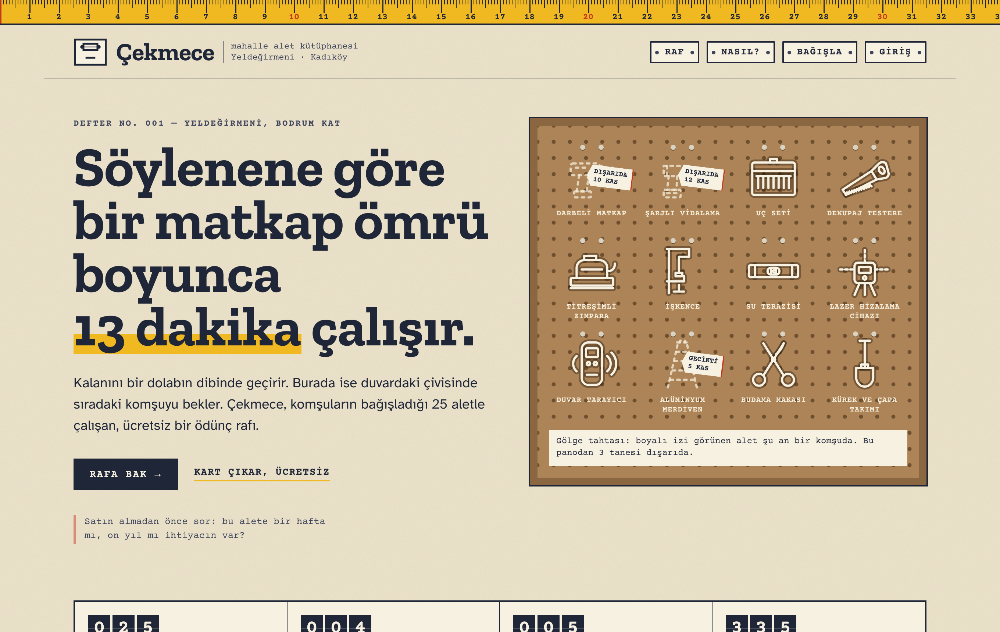

# Çekmece — mahalle alet kütüphanesi



Komşuların matkap, merdiven, kazan, projektör gibi aletleri birbirine ödünç verdiği,
Kadıköy'de geçen kurgusal bir alet kütüphanesi. Hiçbir bağımlılığı yok: npm paketi, framework
ya da build adımı gerekmiyor.

## Açmak için

**`index.html` dosyasına çift tıklayın, o kadar.** Bütün özellikler çalışır: üyelik, giriş, ödünç alma,
sıra, uzatma, iade, bağış ve görevli paneli. Stiller, betikler, fontlar ve çizimler bu tek dosyanın içine
gömülü olduğu için dosyayı tek başına başka bir klasöre, USB belleğe ya da e-postaya koyabilirsiniz.
İnternet bağlantısı gerekmez.

Veriler o tarayıcıda tutulur ve sayfayı kapatsanız da kalır. Alt bilgideki “Defteri baştan yaz” düğmesi
her şeyi örnek veriye döndürür.

### İsteğe bağlı: ortak sunucu

Birden fazla kişinin aynı rafı görmesi isteniyorsa:

```bash
node server/server.js            # http://localhost:4173
node server/server.js --reset    # veritabanını örnek veriye döndür
```

Veri `server/data/db.json` dosyasına yazılır, parolalar `scrypt` ile hashlenir. Sayfa sunucuyu kendisi
fark eder. Sunucu yoksa tarayıcı içi deftere geçer.

### Kodu düzenlemek

`index.html` dosyası üretilmiş bir dosyadır. Asıl kaynaklar `src/index.html` ve `assets/` altındadır.
Bunları değiştirdikten sonra tek dosyayı yeniden üretin:

```bash
node tools/build.js
```

## Deneme hesapları

| Rol            | E-posta               | Parola    |
|----------------|-----------------------|-----------|
| Üye            | komsu@cekmece.local   | komsu123  |
| Masa görevlisi | masa@cekmece.local    | masa1234  |

## Neler var

- **Raf (katalog):** 8 çekmece (kategori), arama, “yalnız raftakiler” filtresi, durum mühürleri
- **Alet sayfası:** iade tarih kartı (hangi mahalleye gittiği), 1–7 gün seçerek ödünç alma, dolu aletler için sıraya girme
- **Üyelik:** yazdıkça basılan üye kartı, giriş/çıkış
- **Kartım:** üzerimdekiler, +7 gün uzatma (sırada bekleyen yoksa), iade, panodaki notlar (bildirimler), sıra durumu, bağış fişleri, geçmiş
- **Bağış fişi:** alet bağışı önerisi, onay için masaya düşer
- **Masa (yönetim):** dışarıdaki/geciken aletler, hatırlatma gönderme, teslim alma, bağışı onaylama/geri çevirme, üye listesi
- **Kurallar ve SSS**

Kurallar sunucu tarafında uygulanır: aynı anda en fazla 3 alet, gecikmiş iadesi olan yeni ödünç alamaz,
uzatma yalnızca bir kez, sıradaki komşunun önceliği var, iade edilince sıradaki kişiye bildirim gider.

## Yapı

```
index.html            ÜRETİLMİŞ tek parça site (çift tıkla aç)
src/index.html        uygulama kabuğu + el çizimi SVG alet ikonları
tools/build.js        her şeyi index.html içine gömen betik
assets/css/style.css  bütün görsel dil
assets/js/core.js     ortak iş mantığı: hem Node'da hem tarayıcıda çalışır
assets/js/api.js      sunucu varsa HTTP, yoksa tarayıcı içi defter
assets/js/app.js      yönlendirici ve sayfalar
assets/fonts/         yerel olarak indirilmiş fontlar (Zilla Slab, Courier Prime, Atkinson Hyperlegible)
server/server.js      bağımlılıksız Node HTTP sunucusu + JSON veritabanı
```

## Tasarım notları

Hazır şablon görünümünden bilerek uzak duruldu: gradyan, cam efekti, yuvarlak köşeli “özellik
kartları”, emoji, ikon kütüphanesi, mor-mavi palet ya da “Elevate your…” başlığı yok. Görsel dil
gerçek bir alet kütüphanesinin nesnelerinden geliyor:

- Sayfanın tepesinde **şerit metre** var; kırmızı kanca sayfada ne kadar ilerlediğinizi gösterir.
- Menü, fiş dolabı çekmecelerindeki **pirinç etiketlik** gibi tasarlandı.
- Ana sayfadaki **delikli pano bir gölge tahtası**: dışarıdaki aletin yalnızca boyalı izi kalır, yanında da etiketi asılı durur. Bu canlı veriyle çalışır.
- Katalog **çizgili kütüphane fişlerinden** oluşur; durum bilgisi mürekkep dokulu **ıstampa mühürleriyle** basılır.
- Alet geçmişi, kitapların arkasındaki **iade tarih kartı** gibi görünür; bildirimler **raptiyeli notlar** olarak gelir.
